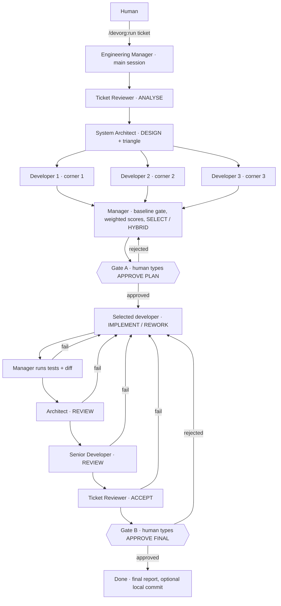

# Architecture

## The roles

| Role | Type | Tools | Defined in |
|---|---|---|---|
| Engineering Manager | **main session** | all (delegates; edits only `.devorg/`) | `skills/run/SKILL.md` |
| Ticket Reviewer | subagent | Read, Grep, Glob | `agents/ticket-reviewer.md` |
| System Architect | subagent | Read, Grep, Glob | `agents/system-architect.md` |
| Developer 1 / 2 / 3 | subagents | Read, Grep, Glob, Edit, Write | `agents/developer-{1,2,3}.md` |
| Senior Developer | subagent | Read, Grep, Glob | `agents/senior-developer.md` |

### Why the Manager is not a subagent

A subagent runs to completion and returns one result; it cannot stop halfway and wait for a
human. The Manager has to pause at two approval gates, so it runs as the **main session**:
`/devorg:run` loads its playbook into the conversation. The six specialists are true subagents,
spawned by the Manager with the Agent tool as `devorg:<name>`.

### Why three developer files that look the same

The developers are deliberately identical except for their name. Their difference — which corner
of the trade-off triangle they optimise — is assigned per ticket by the Manager. They still need
separate files because each must be a separate agent so that (a) the three can run in parallel
and (b) the edit guard can tell which developer is editing (`agent_type` in the hook input).

## Delegation and context isolation

Every subagent starts with an empty context. It knows only:
- its own agent file (role, modes, output format),
- `.devorg/rules.md` (organisation rules, read at start),
- the project's own `CLAUDE.md` (loaded automatically for subagents),
- what the Manager puts in the prompt — the mode, the ticket id and **paths** of record files.

The Manager passes paths rather than pasted text, so each agent reads exactly the evidence it
needs. Developers proposing in parallel are never given each other's proposals; the Manager logs
which files each received, as evidence that the proposals are independent.

## Sequential and parallel execution

Step 4 is the parallel stage (three Agent calls in one message). Everything else is sequential;
reviews run strictly in the order architecture → code → acceptance.

## Enforcement layer

Instructions say what agents *should* do; hooks make the important rules *true*. The plugin
registers four hook entry points (`hooks/hooks.json`), all handled by `scripts/devorg_hooks.py`
via the `scripts/run-hook.sh` launcher. See [safety.md](safety.md).

## Where state lives

| What | Where | Written by |
|---|---|---|
| Project settings | `.devorg/config.json` | `/devorg:init` |
| Organisation rules | `.devorg/rules.md` | `/devorg:init` (team may edit) |
| Workflow state | `.devorg/state.json` | Manager |
| Human decisions | `.devorg/approvals.json` | gate hook only |
| Ticket records | `.devorg/tickets/<ID>/` | Manager |

`.devorg/` is git-ignored. See [workflow.md](workflow.md) for the record files.
