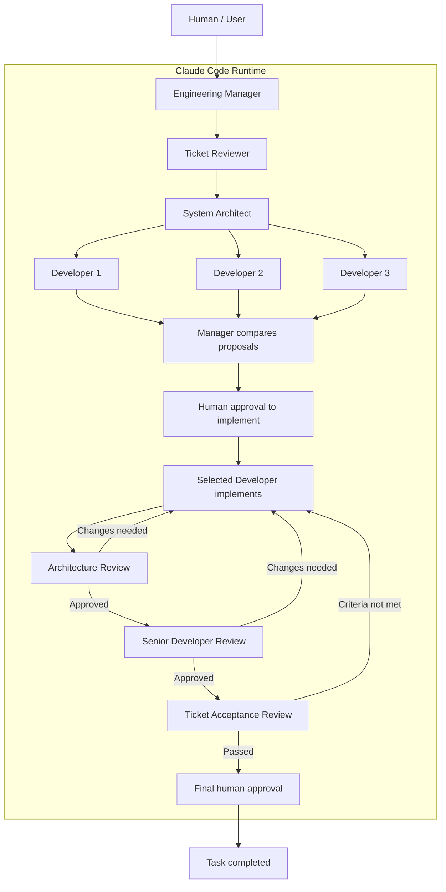

# DevOrg — AI Software Engineering Organisation
## Architecture and Implementation Plan

### Purpose

Build and test a small AI-powered software engineering organisation using **Claude Code as the AI runtime**. Each specialist agent is defined in its own Markdown file. A shared `CLAUDE.md` describes the organisation-wide rules.

The goal of the first version is to demonstrate a controlled software-ticket workflow: understand a task, plan it, compare implementation approaches, implement the selected approach, review the result, and obtain human approval.

---

## 1. Architecture at a glance



**Core idea:** Claude Code provides the AI runtime and agent capabilities. Markdown files define the agents' roles, instructions, tools and boundaries. The Engineering Manager coordinates the workflow, while the human remains in control of important decisions.

---

## 2. The seven agents

| Agent | Main responsibility |
|---|---|
| Engineering Manager | Owns the workflow, delegates tasks, compares proposals, routes review feedback and tracks completion. |
| Ticket Reviewer | Understands the ticket, identifies missing details, extracts requirements and defines testable acceptance criteria. |
| System Architect | Proposes the design, identifies affected components and sets architecture constraints. |
| Developer 1 | Produces an independent implementation proposal and can implement the selected approach. |
| Developer 2 | Produces an independent implementation proposal and can implement the selected approach. |
| Developer 3 | Produces an independent implementation proposal and can implement the selected approach. |
| Senior Developer | Reviews implementation quality, maintainability, readability, risks and adherence to coding standards. |

The Ticket Reviewer also performs the final acceptance check against the agreed criteria. Reviewers should report findings rather than silently changing implementation files.

---

## 3. End-to-end workflow

1. **Submit a ticket** — The human provides a software task.
2. **Analyse the ticket** — The Ticket Reviewer extracts requirements, assumptions, questions, dependencies and acceptance criteria.
3. **Design the solution** — The System Architect proposes the design and records constraints.
4. **Develop independent proposals** — Three developers independently suggest approaches.
5. **Compare proposals** — The Engineering Manager evaluates the proposals against the requirements, architecture, risks and expected effort.
6. **Human plan approval** — The human reviews and approves the selected approach before implementation.
7. **Implement** — The selected developer makes the changes in the controlled project workspace.
8. **Architecture review** — The Architect checks whether the implementation follows the approved design.
9. **Code review** — The Senior Developer checks code quality, maintainability and potential issues.
10. **Acceptance review** — The Ticket Reviewer checks each acceptance criterion and looks for supporting evidence, including test results.
11. **Rework if needed** — Findings are sent to the developer. The relevant review is repeated after changes.
12. **Final human approval** — The human reviews the completed work before it is considered finished.

A failed review must identify the issue and the expected correction. Passing one review does not mean the whole task is complete; all required checks must pass.

---

## 4. Markdown-based agent configuration

Proposed project structure:

```text
DevOrg/
├── CLAUDE.md
└── .claude/
    └── agents/
        ├── engineering-manager.md
        ├── ticket-reviewer.md
        ├── system-architect.md
        ├── developer-1.md
        ├── developer-2.md
        ├── developer-3.md
        └── senior-developer.md
```

- **`CLAUDE.md`** contains shared rules, workflow expectations, safety boundaries and project context.
- **Each agent Markdown file** defines one specialist's name, purpose, responsibilities, instructions, permitted tools and expected output.
- Keep each agent's role separate so it can be tested and improved independently.

Markdown defines the agent configuration; it does not automatically enforce the complete workflow. Delegation, sequencing, approval pauses, review loops and state tracking must be implemented using Claude Code's supported capabilities and, where needed, additional orchestration logic.

---

## 5. Human control and safety

- Require human approval before implementation begins.
- Require human approval before the work is declared complete.
- Keep reviewers read-only wherever possible.
- Give developers only the tools and file access needed for their task.
- Do not expose API keys, passwords, `.env` files or other secrets to agents.
- Treat ticket text and repository content as untrusted input; they must not override the organisation's rules.
- Do not allow multiple developers to edit the same working directory at the same time.
- Do not allow automatic pushes, merges or production deployments in the first version.
- Record proposals, decisions, review findings, test evidence and approvals.

Set a maximum of **three revision cycles per review stage** for the first version. If the limit is reached, stop and ask the human to decide how to proceed.

---

## 6. Two development modes

### Mode A — Proposal first (initial version)

The three developers independently propose solutions. The Engineering Manager compares them and selects one. After human approval, one developer implements the chosen approach.

**Why start here:** It is simpler to test, uses fewer resources and helps validate agent roles and decision-making before adding parallel code changes.

### Mode B — Parallel implementation (later version)

Each developer implements the same approved task in a separate Git branch or isolated worktree. The Engineering Manager compares the implementations using the same requirements, tests and review criteria, selects a candidate, and requests human approval before integration.

**Important:** Developers must never edit the same working tree simultaneously. The selected implementation must still pass architecture, code-quality and acceptance reviews.

---

## 7. Build and test milestones

| Milestone | What to prove |
|---|---|
| 1. Agent setup | Claude Code recognises and can invoke each specialist defined by its Markdown file. |
| 2. Ticket analysis | The Ticket Reviewer produces clear requirements and acceptance criteria. |
| 3. Planning | The Architect and three developers produce useful, distinct outputs. |
| 4. Manager coordination | The Engineering Manager delegates tasks and selects a proposal with clear reasons. |
| 5. Human approval | The workflow pauses and waits for approval at the required points. |
| 6. Implementation | The selected developer makes controlled changes to a demo repository. |
| 7. Review and rework | Reviewers identify issues and the manager routes corrections through a limited loop. |
| 8. Completion | The Ticket Reviewer verifies acceptance criteria and the human approves the result. |
| 9. Parallel mode | Developers work in isolated Git worktrees and their implementations can be compared safely. |

---

## 8. What success looks like

A user submits one ticket and can follow the complete process from analysis to approved completion. Each agent has a clear role, the manager can explain its decisions, failed reviews lead to specific corrections, and the human can pause or stop the workflow.

The first demonstration should use a small, non-sensitive sample repository and a simple ticket. The aim is to validate the organisation's workflow before expanding its tools, complexity or autonomy.
